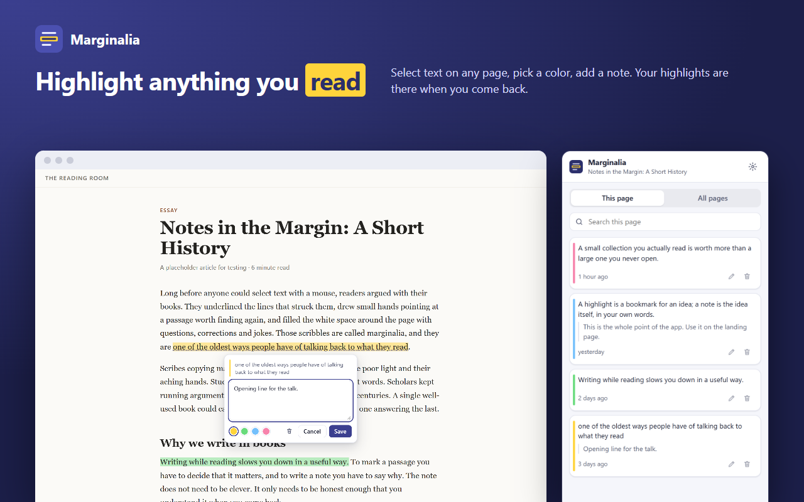
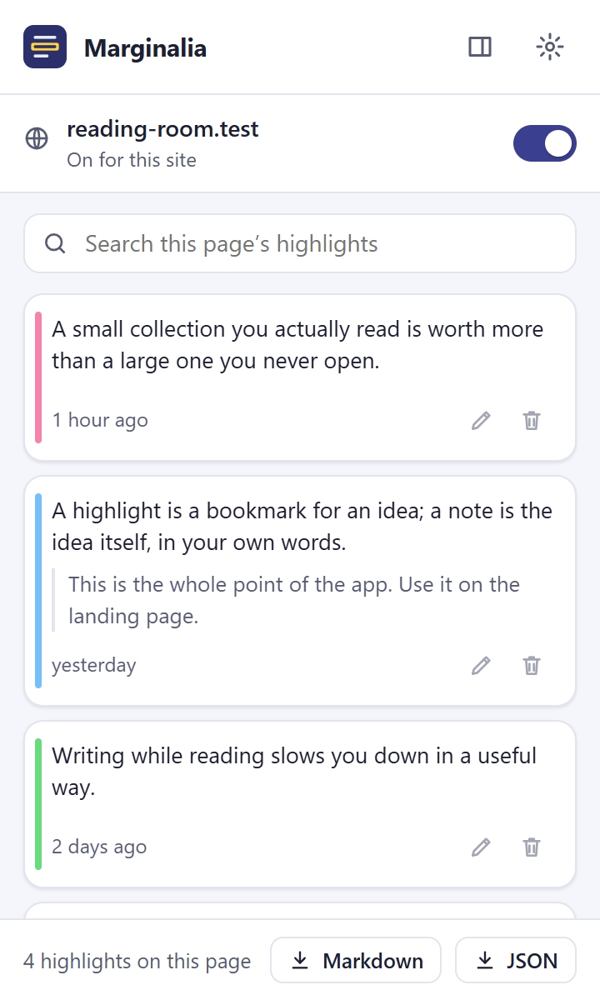
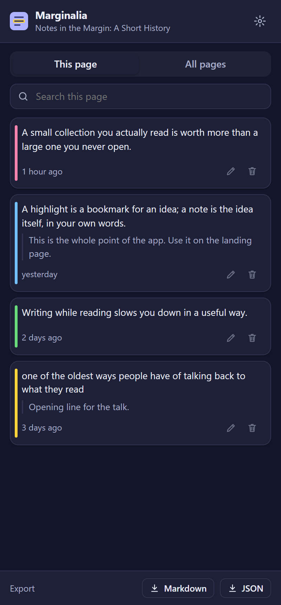
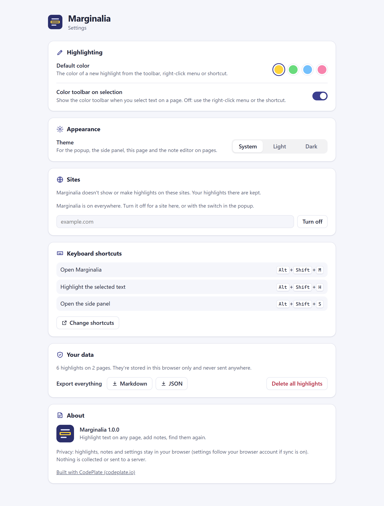

# Browser Extension Starter

> **Free CodePlate template, v1.0.2.** This repository mirrors the zip on [codeplate.io](https://codeplate.io/t/browser-extension-starter/).
> Press **Use this template** to start your own repository from it, or [download the zip](https://codeplate.io/t/browser-extension-starter/).
> [All templates](https://codeplate.io/) · [Free License](https://codeplate.io/license/free/) · subscribers get it under the [Pro License](https://codeplate.io/license/pro/) with no credit.

A complete Manifest V3 browser extension for **Chrome and Edge**, with a **Firefox** build, written so an AI agent can turn it into yours. The sample is **Marginalia**: highlight text on any web page, add notes, and find them again in the popup and side panel.



## What's inside

- **All the parts of an extension, working together:** a content script with an in-page toolbar and note editor, a popup, a side panel, an options page, a service worker with a right-click menu, keyboard shortcuts and a badge count.
- **Typed storage and messaging:** settings in `chrome.storage.sync` with versioned migrations; data in `chrome.storage.local` with one writer; every message between the parts declared once with its request and response types.
- **Small, justified permissions:** `storage`, `contextMenus`, `sidePanel`, and the content script on web pages. Each has a written reason; the checks fail without one.
- **Pages left alone:** highlights are drawn with the CSS Custom Highlight API, so the page's HTML is never changed; the in-page UI lives in a shadow root.
- **Light and dark themes**, search, export to Markdown and JSON, per-site on/off.
- **Checks an agent can run:** `npm run check` runs type checking, lint, unit tests over a fake `chrome` API, the build, a store-style manifest check (permissions, CSP, no remote code, icons) and Playwright tests with the extension loaded in a real browser.
- **Screenshots and store assets from scripts:** `npm run shots`, `npm run store` (1280×800 screenshots, promo tile), `npm run listing` (store listing and privacy policy drafts from the manifest), `npm run zip` (the upload; it refuses the template's placeholders).
- **Optional per-site access, ready to switch on:** a tested helper and a recipe for asking for one site at a time and registering the content script only there.
- **An agent brief and recipes:** `AGENTS.md`, plus eleven step-by-step guides from rebranding to publishing on the Chrome Web Store.

| Popup | Side panel (dark) | Options |
|---|---|---|
|  |  |  |

## Use it with your agent

1. Unzip the template and open the folder with your coding agent (Claude Code or similar).
2. Say what you want: *"Read AGENTS.md, then let's turn this into my extension: …"*. The agent asks a few questions first (what it does, which sites, what data it touches, which browsers, your brand) and records the answers in `docs/project.md`.
3. It works in small steps and runs `npm run check` after each one.

## Run it yourself

Requires **Node.js 22.18 or newer** (24 recommended).

```
npm install
npm run dev            # builds dist/chrome/ and rebuilds on save
```

Open `chrome://extensions` (or `edge://extensions`), turn on **Developer mode**, click **Load unpacked**, and choose `dist/chrome`. After a rebuild, click the extension's reload button and reload the page.

```
npm run check          # everything; ends with CODEPLATE CHECKS: PASS
npm run setup          # once: the browser the screen tests use (or set PW_CHANNEL=msedge)
npm run build:firefox  # dist/firefox/
npm run listing        # docs/store-listing.md and docs/privacy-policy.md drafts
npm run zip            # dist/<name>-<version>-chrome.zip for the store
```

## License

See `LICENSE.md` (CodePlate Free License). Keep the "Built with CodePlate (codeplate.io)" credit in the options page.
